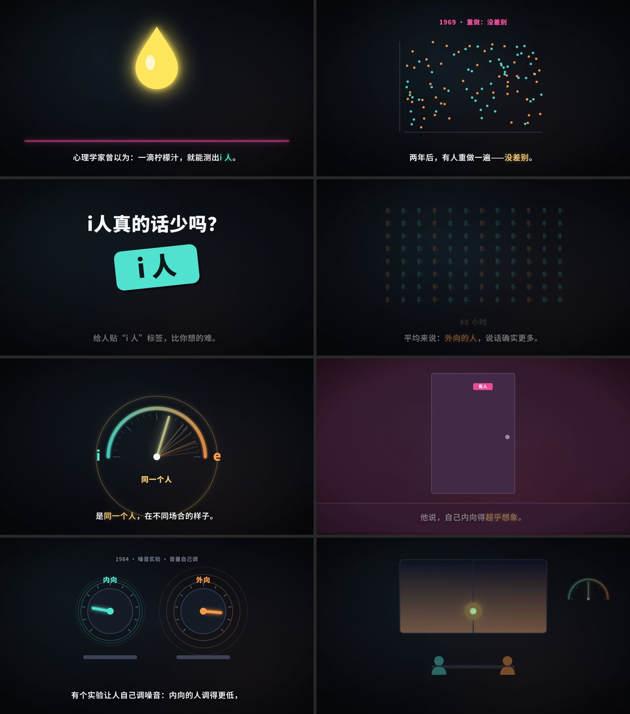
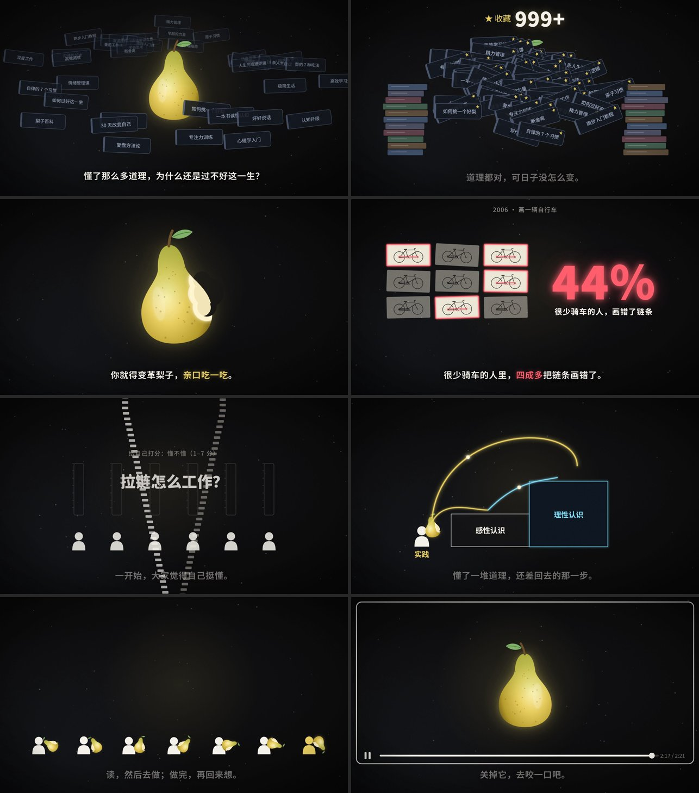

# mw-concept-video

**版本：1.0.0**

**Concept Video：用代码做 2–3 分钟的概念科普短片。画面是代码画的，配乐是代码写的。**

给 AI 一个概念（一个心理学现象、一个哲学观点、一个思维模型），它会陪你选题、查证据、写视频文稿，先做 15 秒样片给你看，确认后做完整片子，最后出 2K 成片。

纯音乐 + 字幕，不配人声；不用网络图片，不用版权音乐，抖音、小红书、B站都能发。

## 样片

| 《i人真的话少吗》 | 《实践论》 |
|---|---|
|  |  |

## 它做了什么

- **开头 2 秒就抓人**：第 0 帧就有画面、字幕和声音，第一句话就是全片要回答的问题
- **一物到底**：一个能画出来的东西贯穿全片（一根指针、一个梨），结尾回到它
- **一句一变**：每句字幕画面都在变，自带节奏测量工具，量出画面多久变一次、换字幕时画面有没有跟着变、有没有静止太久
- **代码写谱**：钢琴、弦乐用 CC0 采样，拨弦和音效用代码合成，音乐和字幕卡在同一条时间轴上；自带配乐体检（响度、峰值、卡点、低频是否太闷）
- **说话有依据**：调研分级核实，引号里只放逐字原文，数字只用查得到出处的

## 安装

将下面这句话发给支持 Skill 的 AI 编程工具：

```text
帮我安装一下 https://github.com/limowan/mw-concept-video 这个 Skill
```

也可以下载仓库后，把 `mw-concept-video` 文件夹放进你的 Skill 目录。

### 需要的环境

| 工具 | 用途 |
|---|---|
| Node.js 18+ | 运行 Remotion 渲染画面 |
| Python 3.10+，numpy、scipy、pillow | 写谱、混音、质检 |
| ffmpeg | 音视频处理 |

装好后让 AI 跑一遍 `tools/check_deps.py`，缺什么它会告诉你。第一次做配乐需要下载约 330MB 的乐器采样，AI 会先问你。

## 怎么用

```text
用 mw-concept-video 做一支科普短片，讲讲“沉没成本”。
```

```text
用 mw-concept-video，我想讲“为什么越忙越拖延”，先帮我想几个选题方向。
```

流程：

```text
选题 → 调研 → 视频文稿 → 前 15 秒样片 → 全片 → 质检 → 2K 成片
```

选题、视频文稿、15 秒样片这几步，AI 会停下来等你确认。配乐好不好听只能你来听，AI 听不见。

完整样例在 `examples/introvert/`：调研、视频文稿、全部场景代码和配乐谱子都在里面。

## 目录

```text
mw-concept-video/
├── SKILL.md            AI 读的主流程
├── references/         设计指南、文稿写法、画面、配乐
├── template/           能直接跑的 Remotion 工程模板
├── music/              写谱引擎、采样下载、配乐体检
├── tools/              环境检查、字体下载、抽帧联系表、节奏测量、检查点
└── examples/introvert/ 《i人真的话少吗》完整样例
```

## 隐私说明

- Skill 本身不提供服务器，不上传、不收集你的任何内容。
- 采样和字体从 GitHub 公开仓库下载；画面和配乐都在你自己电脑上渲染。

## 致谢与第三方许可

- [Remotion](https://www.remotion.dev)：画面渲染。Remotion 有自己的许可证，个人和小团队可免费使用，公司使用请先看它的 [许可条款](https://www.remotion.dev/license)
- [VSCO 2 Community Edition](https://github.com/sgossner/VSCO-2-CE)（Versilian Studios）：钢琴和弦乐采样，CC0 1.0
- 思源黑体、思源宋体（Noto Sans SC / Noto Serif SC）：SIL Open Font License 1.1

## License

本项目采用自定义的 **墨玩非商业使用许可 1.0**，详见 [LICENSE](LICENSE)。

- 可以免费用于个人学习、研究和非商业分享。
- **你用它做出来的视频归你自己**，可以发到任何平台，包括有创作收益的个人账号。
- 使用或再分发本项目时须保留作者署名与许可说明。
- **禁止把本项目本身用于商业用途**（卖模板、收费代做、做进商业产品等）。商用请联系墨玩取得书面授权。

本项目公开分享，但该许可不是 OSI 定义的开源许可证。

## 关于作者

**墨玩** — 独立开发者，和你一起探索 AI 在生活中的有趣用法 🌱

### 我的产品

| 产品 | 说明 | 使用方式 |
|------|------|----------|
| 🌐 墨成AI排版 | AI 快捷公众号文章排版工具 | [mocheng.mowan.work](https://mocheng.mowan.work) |
| 📱 问问毛选 | 毛选语录抽卡，真正的答案之书 | [askmao.cn](https://askmao.cn/) |
| ☀️ 坐哪侧 | 出行选座小工具。坐飞机/高铁时，帮你判断坐哪侧更适合避晒、看日落或赏月 | 微信搜「坐哪侧」或扫码👇 |

**坐哪侧小程序**


### 关注我

| 平台 | 链接 |
|------|------|
| 📕 小红书 | [墨玩](https://xhslink.com/m/3Ks23mHtPrL) |
| 📺 B站 | [墨玩](https://space.bilibili.com/696270041) |
| 💬 公众号 | 微信搜「墨玩」 |


商用授权可通过以上任一公开渠道联系。
